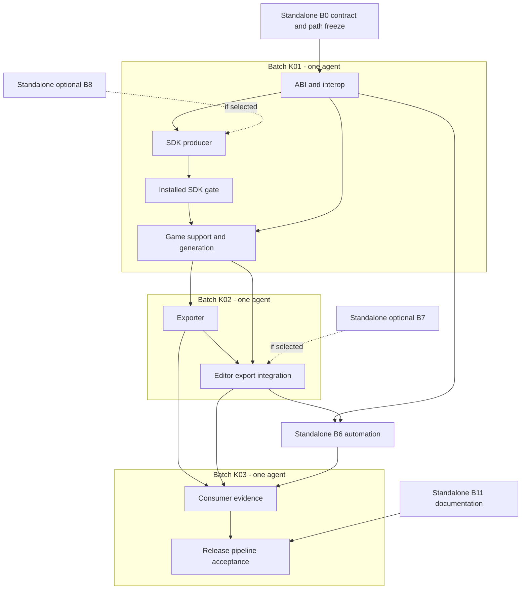

# Separate Engine SDK, game runtime and Editor delivery

**Document ID:** PIXIE-PROPOSAL-021

**Schema version:** 1

**Kind:** reference

**Lifecycle:** current

**Subject:** proposed contracts, atomic blocks and single-agent batches for SDK and Editor separation

**Surface:** proposal

**Boundary:** global

**Authority role:** non-normative

**Mutation:** authored

**Indexing:** include

## 1. State, objective and owner direction

**State:** promoted by the owner on 2026-11-04 to
[`PIXIE-TODO-060`](../../TODO.md#pixie-todo-060--separate-engine-sdk-game-runtime-and-editor-delivery).
**Idea:** make Engine independently consumable as an SDK, give games a qualified
runtime distribution, and extract Editor into an independently owned project that
consumes the SDK. Preserve Inspector and Lib as independent dependencies.
**Rationale:** source-checkout assumptions currently couple building, loading,
authoring, export, qualification and release. Removing a directory from a repository
does not resolve those contracts.
**Promotion outcome:** accepted scope, gates and completion belong to `PIXIE-TODO-060`;
its [TASKLIST breakdown](../../TASKLIST.md#pixie-todo-060--engine-sdk-game-runtime-and-editor-separation)
owns task state, dispatch, decision prerequisites and integration ordering. C01-C12
are accepted behavioral targets. Subsequent owner decisions and scoped clearances
belong to TASKLIST: D01-D07/D10-D11 are accepted, D08-D09/D12/D14 remain open,
B7 is conditional/unassigned, B8 inactive and D13 deferred outside this scope.
Promotion itself dispatched no unit or implementation.
The owner's subsequent five-chat preparation assignment is recorded only in the
TASKLIST dispatch register; applicable G0 and decision prerequisites remain open.
The B/C/D/G/K/M labels below preserve the originating contract and
ownership rationale; they are not a second scheduler.
**Source:** the owner's separation request, two targeted sweeps dated 2026-11-04,
and the owner's clarifications about batch assignment, completed proposal 018 and
the future VAW installation/rebind. Those corrections govern this revision.

The requested outcome and constraints are established direction:

- Engine provides development inputs and runtime artifacts without requiring its
  source checkout in a consuming Editor/game project.
- Editor can have its own project/repository and release identity. Engine must not
  acquire a dependency on Editor, Inspector or application UI.
- Inspector and Lib are within the impact assessment; changes there are conditional
  on actual contracts, not an automatic redesign or coordinated version increase.
- Work must be decomposed into exclusive ownership units with explicit dependencies,
  handoffs and acceptance gates before parallel implementation. A batch groups whole
  blocks for one agent; it is not a chronological wave of work for several agents.
- The original drafting request did not authorize implementation. The 2026-11-04
  promotion records the accepted work and its gates in `PIXIE-TODO-060`; no source
  move, project creation, implementation, commit or publication occurs in this
  documentation change.

### Explicit permission for projects outside Engine

The owner permits projects introduced by this separation to have their own folders
outside the PixieEngine repository. The future implementation may use separately
owned local projects/repositories for Editor, bindings, tools or consumer fixtures
where the accepted boundaries justify them. These projects do not have to remain
nested in Engine. This structural permission is retained when this proposal is
promoted; it is not a requirement to create every optional project or a remote
repository now. Physical paths and names remain D14 decisions.

No build, loader, test or product contract may require those projects to be siblings.
A convenient local workplace layout is a development arrangement, not an installed
SDK discovery mechanism.

### VAW work in parallel

The owner is correcting VAW to treat PixieEngine, PixieInspector and PixieLib as one
workplace, enabling documentary consistency across the three projects. This is an
accepted coordination direction and an external workstream in progress, not a
completed capability claimed by this proposal. Do not recreate three unrelated
documentation systems or implement a competing workplace model here.

VAW is still being updated and will only be installed/rebound afterward. Its delivery,
installation, rebind, new-member registration and validation are **not prerequisites**
for dispatch, implementation, documentation completion, extraction or release readiness
under this proposal. No gate waits for a VAW handoff.

Maintain coherent document ownership, identity, routing and cross-project references
using the repository rules currently available. After VAW is installed/rebound, those
records can inform a separate adoption step for the three projects and any new Editor.
One workplace does not imply one Git repository, one product version, one binary,
one release or filesystem adjacency.

Do not implement a competing workplace framework or change VAW as part of separation.
B11 completes the product documentation without waiting for it. D13 is a deferred,
nonblocking follow-up, not an implementation decision gate or a new installation task.

## 2. Evidence and corrected baseline

The sweeps are local assessment records `LOCAL-SDK-SEPARATION-SWEEP-20261104` and
`LOCAL-SDK-SEPARATION-DEEP-SWEEP-20261104`, with a companion block sketch. This
proposal consolidates their planning content; local reports remain evidence, not
required inputs for reading this document. The second sweep's corrections replace
the first sweep's shorthand wherever they differ.

| Repository | Inspected HEAD |
|---|---|
| PixieEngine | `312f07a1790fcc32821aa4e2f84f708d1ef5274f` |
| PixieInspector | `c4dccc9c2bb7df7619f09e6b6da6cd7c5750d8b5` |
| PixieLib | `a23ca6d2b896bbe34cb8180edba7701ddb12560e` |

Engine had existing unrelated uncommitted proposal/player/export work; inspected
bytes were not all HEAD bytes. The completed 018 implementation was already committed.
Inspector and Lib were clean. Reconcile the outstanding owners'
work before freezing an execution baseline. Do not overwrite ScreenCanvas,
ProjectApp, PlayerExit or the existing proposals as separation housekeeping.

The first pass inventoried 1,100 non-vendor files. The deeper pass captured targeted
evidence for 70 source files, six existing local artifacts and 18 corresponding
non-test native Lib files. Neither sweep configured, restored, built or ran the
product. Cached outputs show only those artifacts; they do not prove the active
process, published package contents or an installed SDK. Feasibility remains an
architectural inference until the gates below pass.

| Finding | Confirmed observation and corrected interpretation | Proposed response |
|---|---|---|
| F01 | [Root CMake](../../CMakeLists.txt) builds one shared runtime; public facades and the legacy [Pixie::Engine alias](../../engine/CMakeLists.txt) are not separate runtime products. No owned installed SDK interface was found | C01/C03, B1; define public targets without exposing internal object libraries |
| F02 | Public dependencies include PixieLib/GLM, EnTT and GLEW headers; static PixieLib math propagates in the link interface. Compiler/CRT/CPU assumptions also matter | C02/C03/C09, B1/B8; distinguish build closure from runtime closure |
| F03 | Proposal 018 delivered ABI 28 and cooperative contract1 candidate reconstruction with pinned module/session lifetimes. [Module entry](../../capi/src/GameModuleEntry.cpp) still returns a C++ Project pointer; this delivery does not establish arbitrary SDK/toolchain ABI compatibility | C02/C04, B4; preserve the delivered admission/lifetime contract while adding package identity |
| F04 | Game helpers compile support sources from Engine. [ProjectCode](../../editor/PixieEditor/Native/ProjectCode.cs) recognizes legacy template text and validates registry hashes/markers; [custom bootstrap](../../cmake/PixieInitComponents.cmake) is another shared surface | C05, B2/B5; version generation and migration contracts together |
| F05 | [Exporter](../../tools/export/Export.cpp) embeds producer paths, labels engine_version from its own build, uses its linked runtime's asset descriptors and resolves additional DLLs beside the player. 018's v2 scopes/presentation are implemented authored data, not a future schema | C07, B3; preserve complete authored files and verify asset/identity closure against that baseline |
| F06 | [Loader](../../editor/PixieEditor/Native/GameLibrary.cs) selects pixie.dll beside the game module. 018 already delivered full-document history, committed binding recovery and state-preserving real rebuild; [EngineSession](../../editor/PixieEditor/Native/EngineSession.cs) is part of that editor coordinator | C04/C06, B4/B5; relocate and preserve these behaviors, not reimplement a thin session wrapper |
| F07 | Native development/module loading and channel capabilities are separate from Debug/Release. Managed publish removes export UI with automation, but code-project loading still needs native module support | C01/C10, D10; do not relax publish guards without a product decision |
| F08 | Inspector's extra field-interaction flags/icons depend on a local-root property. 018's session/Scene implementation was already qualified in package and local Inspector modes; its preservation is not conditional on selecting those extra features. Core/view pairing and explicit field mapping remain separate contracts | C08, B5/B7; preserve 018 in both admitted modes and decide only the additional Inspector feature baseline |
| F09 | Vendor native Lib and standalone Lib differ in event callback/handler files in the bounded comparison; no event use was found in 277 examined Engine C++ files. That does not require an upgrade or prove universal ABI parity | C09, D04; select the supported dependency surface and provenance |
| F10 | 018's completed native/editor/module/MCP qualification is regression evidence for its source baseline. [MCP qualification](../../tests/mcp/qualify_mcp.py) still recreates an Engine ancestor layout, and read-only source remains readable fallback input | C10, G1-G5; retain 018's cases and add artifact independence evidence instead of reopening its completion |
| F11 | Engine CI builds the nested Editor; packaging/release ownership is unsplit. Current documentation validation rejects relative links outside the repository; future VAW installation is outside this work | C11/C12, B10/B11; complete current documentation/release ownership without a VAW dependency |

Two local GLFW DLLs had different hashes: Engine's built DLL and Editor's Hexa
runtime asset. This confirms distinct provenance, not a demonstrated loading or
context conflict. Likewise, exporter entity traversal alone does not establish a
Scene v2 defect: the examined v2 fixtures retain top-level entities. Those distinctions
must survive implementation planning; uncertainty is not a new confirmed issue.

### Reconciliation with completed proposal 018

[Proposal 018](world-scene-reconciliation.md) was completed as
[PIXIE-TODO-057 / PIXIE-ARCHIVE-091](../archive/todo-057-world-scene-reconciliation-2026-11-04.md).
The four implementation commits are `cf86a50`, `f3504ca`, `15ab5f8` and `cc8dc46`;
the inspected HEAD `312f07a` records closure. Its baseline is product 0.3.0.0,
native/editor ABI 28, scene envelope v2, presentation schema 1 and cooperative
module contract1. The early checkpoints preserved in the archive do not override
its completed technical boundary and final task outcomes.

| Delivered boundary | Consequence for separation | Owning surface / regression evidence |
|---|---|---|
| World execution with shared registry/clock/solver, stable logical scopes, World-only membership, empty scopes and deferred transfers | These are public runtime semantics to package and preserve; SDK extraction does not introduce independent Scene loading/solvers | [World.hpp](../../runtime/include/pixie/runtime/World.hpp), [Scene.hpp](../../runtime/include/pixie/runtime/Scene.hpp); native Scene/runtime tests; C03/C05 |
| Persisted v2 document, distinct entity/scope IDs, seed, unknown/opaque data and inactive values; compatible v1 behavior and explicit backed-up conversion | No automatic v1-to-v2 migration during SDK switching, build or export. Preserve .v1-backup and dirty-state refusal paths; template migration is a separate concern | [Scene.cpp](../../runtime/src/Scene.cpp), [ProjectSession](../../runtime/include/pixie/runtime/ProjectSession.hpp); SceneAuthoringTests; C05-C07 |
| ABI 28 candidate proposals, three-field session/storage/authored token, qualified fallback or explicit contract1 module, fresh Project/descriptors/World and pinned DLL lifetime | SDK capability/ABI checks are additional admission, not replacements for candidate checks. Unsupported authored types and raw live-v2 restore retain their rejection behavior | [C API](../../capi/include/pixie_capi.h), [module contract](../../capi/src/GameModuleEntry.cpp); ModuleSceneTests and CAPI tests; C02/C04 |
| Shared GUI/script/channel admission, full-document v2 Undo/Redo, prepared-edit freshness and recovery after committed publication | EngineSession, SceneDocumentEditor, SessionEditGate, history and recovery remain a coherent Editor-owned boundary. Rebind failure must retain the committed World/history, not pretend publication rolled back | [SceneDocumentEditor](../../editor/PixieEditor/Editing/SceneDocumentEditor.cs); SceneCandidateTests and repaired-load fixtures; C04/C06/C10 |
| Complete dirty authored state and stable World/Scene/entity selection through Play/Stop, save/reopen and real process rebuild | CodeReopen already transports a full snapshot, not merely entity fragments. Add SDK/profile continuity around this delivered lifecycle without dropping scopes, defaults or navigation | [CodeReopen](../../editor/PixieEditor/Native/CodeReopen.cs); ProcessReopenTests; C06/G4 |
| Separate Environment/view/Renderer authorities, stable Camera2D intent, explicit viewport camera/Environment and same-World framebuffer contexts | Preserve native resolution used by render/picking/gizmos, expired-target fallback, absent/disabled lighting and serial GL-state restoration; selection does not implicitly choose a Scene view | [Presentation2D.hpp](../../runtime/include/pixie/runtime/Presentation2D.hpp), [ViewportCamera2D.hpp](../../runtime/include/pixie/runtime/ViewportCamera2D.hpp); presentation/input/lighting cases; C03/C06/C08 |
| Persisted Inherit/Multiply/Override gravity, qualified local motors and dynamic particle pools; approved global-body fallback | Preserve the activated motor/pool path and global rigid-body gravity. Local-body compensation failed its sleep criterion and is not a pending prerequisite of this separation | [runtime qualification](../../tests/qualification/local-gravity/RESULTS-Runtime-2026-11-04.md); runtime consumer tests; C03/G1/G4 |

The completion record reports 31 CTests for each native preset/configuration,
managed candidate/Scene/module/recovery/presentation/input checks in package/local
Inspector modes, 14 real rebuild checks per published configuration, 191 MCP cases
per configuration and 42 LightMachine checks per configuration. These are inherited,
bounded results, not tests rerun here and not installed-SDK qualification. G1-G5 must
exercise the affected delivered contracts through the new package/editor boundaries.

Keep the delivered limits too: candidate publication protects session-owned storage
under a cooperative module contract, not arbitrary external callback effects; custom
authored types require declarative admission; opaque unregistered payload remains
opaque; no conflicting-scope remap, loading workers, VM qualification or independent
Scene streaming/solver model was delivered. AO/normal data keeps its read-only
compatibility authority. Expanded visuals were not owner-reviewed, but 018 has no
remaining blanket visual-approval completion gate. Do not reopen that closed work;
record visual regression evidence for changed separation surfaces on their own merits.

One documentary discrepancy remains visible: the CAPI reference's overview still
says API 27, while the header, managed binding and completion record establish 28.
This proposal uses the implemented 28 baseline. B11 includes this consumed-boundary
reference correction; it is not evidence that 018's implementation is incomplete.

## 3. Proposed product and responsibility boundaries

These are roles to separate, not a decision that every row needs a new repository.

| Role | Responsibility | Must not require |
|---|---|---|
| Engine SDK producer | Public headers/targets, link dependencies, module/player support, generation inputs, identity metadata and selected authoring tools | Editor source or managed UI packages |
| Authoring runtime profile | Native sessions and game-module support needed by the selected Editor/SDK tools | Shipping runtime being interchangeable merely because its filename/version matches |
| Shipping runtime profile | Engine/native/CRT closure used by exported game executables | Editor, development game modules, build sources or local automation |
| Native export tool | Plan/build or assemble qualified game products, collect assets, verify shipping closure | Producer-machine paths or an unselected Engine checkout |
| Editor application | UI, edit/history policy, Inspector adaptation, project workflows and SDK selection | Engine/Inspector/Lib source checkout in package mode |
| Inspector family | Engine-independent managed inspection core/views and their package contracts | An Engine dependency introduced for Editor convenience |
| Lib | Primitive/math/event semantics, native dependency provenance and managed package contracts | A forced platform or version change caused solely by Editor extraction |
| Development automation | Explicitly selected native/editor adapters and protocol qualification | Unconditionally entering public artifacts or games |
| Future VAW integration, outside separation | Adopt the unified workplace after its later installation/rebind | Any separation gate waiting for that delivery or a product dependency on workplace layout |

Retain the existing single native runtime as the planning baseline. A multi-DLL
redesign is not necessary to this objective and requires a separate scope decision.
Packaging profiles together or separately, managed-binding delivery, standalone Lib
packaging and any additional tools repository remain open.

## 4. Proposed contracts

The obligations below supply the C01-C12 behavioral targets accepted by
`PIXIE-TODO-060`. Their associated decisions retain the dependent implementation
gates in its TASKLIST breakdown. Representation choices remain separate from
required behavior; promotion selects no open alternative.

### C01 — Products and capability profiles

B0 records a product/profile table covering platform, architecture, configuration,
CPU baseline, module loading, native/editor automation and authoring export. B1 emits
that identity; B3/B5/B6 consume it. Debug/Release and a DLL basename cannot serve as
capability identity. A code-authoring Editor requires a module-capable runtime;
shipping games exclude development modules/channel code. Public authoring-tool
policy is D10; package grouping is D03. Existing exclusion rules stay in force until
their specific replacement is accepted, including qualification updates.

### C02 — Compatibility identity and lifetime

B4 defines how a consumer establishes native C ABI and C++ module compatibility.
The proposed identity covers immutable producer identity, platform/architecture,
compiler/toolset/standard-library policy, CRT/configuration, public dependency/options
and capabilities. Product version, C API version, scene schema, candidate-authoring
contract and private reopen format remain separate axes. D02 selects exact matching
or a supported compatibility range and its evidence requirements.

Reject unsupported combinations deterministically, before invoking incompatible
interfaces where technically possible; explicitly document any check that requires
OS loading first. Preserve the existing module leases and session destruction order.
Do not claim that C API version matching alone validates C++ callbacks, descriptors,
vtables, STL or EnTT objects.

The 018 contract1 factory/admission and ABI28 session/storage/authored token checks
are already implemented. Matching an SDK identity must not bypass them, broaden
custom-type admission, or turn cooperative reconstruction into an external-effect
rollback promise. The separation adds package compatibility around this contract.

### C03 — Installed SDK and public build targets

B1 supplies a relocatable public target/include/link contract, including the selected
legacy aliases, compiled math and public third-party dependencies. Producer-only
export macros and private implementation targets do not leak into consumer usage.
CPU support of prebuilt binaries is recorded, not inferred from consumer flags.
Dependencies, notices and provenance accompany their owning artifacts.

Include 018's World/Scene, presentation, viewport and gravity-resolution public
surfaces in the exported header/target closure. Preserve the delivered global-body
fallback and activated local motor/pool behavior; neither is a new SDK design choice.

Package consumption works with the producer checkout unavailable and does not rebuild
Engine. Source-development mode may remain explicitly selectable. Silent source
fallback is prohibited in package mode. D01/D03/D04 select supported tuples, packaging
and dependency delivery; they do not remove the independence requirement.

### C04 — Managed/native binding and runtime resolution

B4 owns native ABI and low-level interop delivery; B5 owns GameLibrary, EngineSession,
edit gates, history and Inspector adaptation. A binding extraction cannot pull those
editor policies into a supposedly generic SDK assembly by accident. D05 chooses
editor-local declarations, Engine-delivered source, or a binary binding interface.
If imports move assemblies, their resolver must follow the actual P/Invoke assembly.

B5 consumes an explicit selected runtime identity and capability profile. D06 selects
module-adjacent staging or SDK-based resolution and defines discovery precedence.
Neither ancestor scanning nor a same-named DLL silently overrides that selection.
The handwritten editor API constant and header-derived MCP metadata need one deliberate
versioning route; sharing a name does not make them generated from the same source.

In particular, keep 018's SceneDocumentEditor, SessionEditGate, full-document history,
prepared-edit freshness and committed binding-recovery responsibilities with B5.
B6 consumes the same admission through its adapters. Low-level interop relocation
must preserve token/receipt layouts and the candidate commit/recovery distinction.

### C05 — Project build, support code and generation

B2 delivers player/module support, CMake helpers, templates, registry schema/markers
and custom bootstrap as a coherent SDK surface. B4 owns the module-entry contract;
B2 consumes the frozen result. B5 consumes the generator contract rather than inventing
another registration format. A generic no-code player must be supplied or buildable
from declared package inputs; its current top-level-only target is not an installed
artifact guarantee.

D07 selects versioned legacy templates, migration rules or a common generator tool.
Preserve user component code, custom CMake layouts, hashes/preimages and refusal paths.
Test new, recognized legacy, registered and unfamiliar custom projects. Project files
can express an SDK requirement without persisting a mandatory machine-local absolute
path. D06 also covers toolchain selection and cache identity.

Generator migration does not authorize scene-format conversion. Existing v1 files
remain v1 until the delivered explicit backed-up operation is invoked; SDK selection
must not bypass 018's file/dirty-state safeguards or admitted component-type rules.
Retain explicit cooperative module opt-in; template recognition alone must not grant
contract1 or arbitrary custom-type authoring permission.

### C06 — Editor process and authoring-state continuity

One SDK/profile selection must survive build, module load, process restart and reopen.
B5 preserves existing project/scene data, unsaved handoff state, selection, viewport
choices and history/edit boundaries to the accepted feature baseline. Do not discard
user presets or rebuild caches blindly to hide a mismatched SDK. Supported launch
forms and cache/profile migration behavior are explicit outcomes of D06.

Editor has its own product identity and can identify the selected Engine separately.
Qualification covers two installed SDKs, explicit mismatch, relocated paths and a
code rebuild with unsaved state. The preserved baseline includes 018's persisted
scope authoring, candidate reconstruction, full-document history/recovery and
canonical camera/Environment intent, with its qualified local motor/pool gravity.
No local rigid-body gravity activation or broader custom-type admission is added.

### C07 — Export planning, runtime closure and manifest identity

B3 remains the native export implementation; B5 discovers/invokes its accepted CLI.
Tool, descriptor/schema interpretation, selected runtime and manifest provenance must
agree. D11 chooses paired SDK tools or explicit metadata-driven selection and the
separation/reuse of package validators. An exporter's own version cannot silently label
a different selected runtime.

Support code and no-code exports, declared game assets and runtime dependency closure
without producer paths. Missing DLLs must fail clearly even if their source location
is outside the player's directory. Preserve current shipping exclusions. SDK/editor
payloads need their own explicit policy because headers, import libraries and tools
are intentionally forbidden in game exports. Platform coverage is limited by D01;
current PE validation is not evidence for non-Windows export support.

Preserve 018's complete v2 scopes, presentation, seed and opaque data in exported
scene documents. Asset discovery must be checked against that schema and the selected
runtime descriptors, including declared custom assets; successful traversal of the
entities array alone is not full preservation evidence. Export must not implicitly
convert an authored v1 document or reactivate the rejected body-force experiment.

### C08 — Inspector features and managed native assets

B7, if activated, supplies the selected package core/view pair and feature evidence.
B7 can qualify immutable local packages; remote publication is not a prerequisite
for this preparation and remains subject to C12/D12.
B5 owns adoption: package reference, feature conditions, icon assets, semantic field
mapping and grouped-history behavior. D08 selects the preserved feature baseline;
package publication alone cannot activate local-root-conditioned code. Package-only
qualification must not require the sibling Inspector source checkout.

018's qualified session/scope/history behavior is part of the preservation baseline
in both Inspector modes. D08 selects the additional local field-interaction feature
baseline, not whether to retain the completed Scene implementation.

B5 also owns the Editor artifact's Hexa/GLFW/ImGui/backend closure. D09 is resolved
with actual loaded paths/hashes and create/render/dispose context evidence, then a
choice to retain, align or consolidate providers. Preserve caller-owned GL context
requirements. Do not infer a conflict from unequal DLL hashes alone.

### C09 — Native and managed Lib provenance

B1 records the native dependency/modules it supplies. D04 selects containment of
the existing vendor closure, an independent native Lib package, or a separately
qualified update. B8 is activated only for the selected Lib-owned work. No silent
vendor patch or mandatory managed-package upgrade follows from separation.

If events are advertised across binary boundaries, qualify their relevant callback
lifetime/copy/move semantics. Absence of current Engine use does not qualify future
users. Preserve Lib's C++/C# semantic/layout contract and other target frameworks.
Its source generator is a build-time dependency, not game-runtime payload.

### C10 — Automation and qualification ownership

B6 owns native/editor protocol adapters and local automation fixtures. B5 owns authoring
export UI even where it currently lives under Development. Capability policy follows
C01/D10 rather than directory names. B9 owns artifact-consumer fixtures independent of
producer source; B0 alone registers shared root tests. Test roots, outputs and exact
artifact identities are explicit inputs, not ambient shared bin directories.

Native C API tests stay Engine-owned. Editor behavior tests follow Editor. Cross-product
tests record their product tuple. Historical shared-boundary/source-build tests retain
their stated purpose; they cannot be renamed as proof of installed-package independence.

### C11 — Documentary consistency without a VAW prerequisite

B11 produces a document map using the rules available for this work: fact/contract,
authoritative project, canonical location, stable identity, cross-project reference
rule and applicable validator. Maintain one owner for each fact across Engine,
Inspector, Lib and the extracted Editor; do not duplicate mutable contracts because
their files live in different repositories. Minimum SDK/Editor guides and reference
repairs are part of separation, including the API28 overview correction noted above.

Complete this mapping and its checks without requiring the updated VAW to exist,
be installed, be rebound or accept new members. Choose working references supported
by current validators; document a bounded limitation instead of depending on future
tool behavior. No new workplace/schema framework is implemented here.

D13 records only later adoption after the owner's separate VAW work is
installed/rebound. That follow-up may reuse this ownership map and reconcile routes
without making separation incomplete retroactively. Broader documentation rewriting
and inline API formalization remain later work. No VAW files, installation operations
or binding mutations are assigned to these blocks or required by G6.

### C12 — Independent release products and provenance

B10 prepares independent Engine SDK/runtime and Editor pipelines consuming immutable
producer artifacts and the accepted compatibility tuple. Preserve Inspector/Lib's
independent release ownership. D12 selects triggers, version rules, dependency locking,
artifact channels and retention; automation is not permission to publish every commit.

Before any future publication, validate the exact payloads, capability exclusions,
dependency/native assets and provenance. A workplace-wide documentation check does
not force a shared release number. Remote repository creation, tags, pushes and releases
follow their explicit authorization/trigger policy; none occur under this proposal.

## 5. Open decisions and their deadlines

At promotion, items were **open** except D13, which remains **deferred outside this
scope and nonblocking**. This table retains the alternatives and prerequisite rationale;
current outcomes belong to the promoted TASKLIST section. Options are not accepted
implementation choices. The owner accepts product/scope decisions; block owners
prepare technical evidence. An unresolved item blocks only its dependent
implementation/gate, not unrelated preparation.

| ID | Decision and alternatives | Needed before | Contracts/blocks affected |
|---|---|---|---|
| D01 | Initial binary support tuple: bounded Windows/MSVC configurations or a broader qualified set; CPU baseline and toolchain support | B1 artifact production and B9 expected tuples | C01-C03/C07; B1/B2/B3/B4/B9 |
| D02 | Compatibility policy: exact SDK/toolchain matching or a documented compatible range; identity fields and rejection timing | B4 compatibility implementation | C02; B1/B2/B4/B5/B9 |
| D03 | SDK layout/profiles and public target names: one package with named profiles, separate packages, or explicit source-built variants; legacy aliases | B1 package interface freeze | C01/C03; B1/B2/B3/B5 |
| D04 | Native Lib strategy and advertised modules: existing contained closure, standalone package, or separately qualified update; events included or excluded | B1 dependency closure; activation of B8 | C03/C09; B1/B8 |
| D05 | Managed interop delivery: editor-owned declarations, Engine-owned source delivery, or binary package; resolver and version-metadata ownership | B4/B5 interface freeze | C02/C04; B4/B5/B6 |
| D06 | SDK selection/discovery, runtime placement, supported launch forms, compiler/cache/preset migration and portable project requirement | B2/B5 consuming implementation | C04-C06; B2/B5/B6 |
| D07 | Template/registry evolution: preserved legacy families, explicit metadata migrations, or a common generator tool | B2/B5 generation changes | C05; B2/B5 |
| D08 | Inspector baseline: existing package behavior or package delivery/adoption of current local features; reproducible resolution | B5 feature-parity target; activation of B7 | C08/C12; B5/B7 |
| D09 | Native graphics asset policy: retain separate providers, align versions or consolidate after a load/context experiment | G4 packaged Editor acceptance | C08; B5/B9 |
| D10 | Public authoring/export/module capabilities and local-only automation; precisely which prior publish exclusions change | B1 profiles, B5/B6 publish changes | C01/C10; B1/B3/B4/B5/B6 |
| D11 | Exporter/runtime pairing, product manifest/schema boundaries and nonadjacent dependency resolution | B3 implementation | C07; B1/B3/B5/B9 |
| D12 | Independent release versions, triggers, dependency locks, channels and artifact retention | B10 executable pipeline policy; G6 | C12; B0/B7/B8/B10 |
| D13 | Deferred follow-up: adopt the unified workplace after its later installation/rebind, reusing the separation document map | No block or gate in this proposal; handled separately afterward | Future VAW adoption only; C11 completes independently |
| D14 | New project folders/repositories, optional binding/tools project and extraction/history strategy; future VAW membership is not a prerequisite | New namespace reservation and B0 extraction transaction | C04/C11/C12; B0/B4/B5/B10/B11 |

The permission to use external folders and the single-workplace direction are already
given. D14 decides the project's physical realization; D13 preserves a future adoption
topic without blocking this work. Neither asks the owner to authorize the direction again.

## 6. Atomic ownership model

An atomic block has one accountable owner, exclusive write paths, versioned input/output
contracts, a reviewable result and a bounded acceptance gate. It can contain multiple
commits; it is not necessarily independently mergeable before its prerequisites exist.
Disjoint files prevent edit collisions. Frozen contracts and isolated outputs address
semantic/build collisions; no plan promises zero integration risk.

B0 is the integration block, with one agent owning its serial transactions for contract
freeze, root registrations and final extraction. B11 also has one owner across mapping
preparation and final reconciliation. Their milestones do not create sub-assignments
for other agents. B1-B10 represent bounded implementation ownership; optional blocks
stay inactive until selected. Whole-block and whole-batch dispatch rules are in section 7.

### Exclusive path allocation

Paths below are Engine-relative unless a repository is named. Directory sets contain
tracked, relevant non-documentation files only. Markdown documentation is allocated
explicitly to B11 or the peer-repository owner; generated/ignored output is not a source
write set. Ownership permits only changes required by the block, not arbitrary rewrites.

| Block | Exclusive write surface and explicit exceptions | Deliverable and acceptance |
|---|---|---|
| B0 Contract/integration | Root CMakeLists.txt, CMakePresets.json, tests/CMakeLists.txt, version.json, .gitignore/.gitattributes if required; proposal/index and TODO/TASKLIST/ROADMAP integration; final source-removal/destination-addition transaction | Decision/contract freeze, exact path ledger, root wiring and coordinated move; no duplicate/unassigned intended writes |
| B1 SDK producer | engine/CMakeLists.txt and engine/{core,platform,render,app}/CMakeLists.txt; runtime/CMakeLists.txt; capi/CMakeLists.txt; external/CMakeLists.txt; cmake/PixieTargetDefaults.cmake; reserved cmake/sdk/** and scripts/sdk/** | Relocatable profiles, public targets, dependency closure and SDK manifest; G1. Root registrations go through B0 |
| B2 Consumer build/generation | cmake/PixieProject.cmake, PixieGame.cmake, PixieAddCode.cmake, PixieComponentRegistry.cmake, PixieInitComponents.cmake; templates/**; runtime/player/**; tests/project-code/** | Installed-package game/support/generation contract; G2 generation cases. Module entry remains B4-owned |
| B3 Exporter | tools/export/**; cmake/PixieExportProduct.cmake; tests/export/qualify_export.py | SDK-aware native export and product-policy verification; G3. No editor UI ownership |
| B4 Native ABI/interop | capi/** except capi/CMakeLists.txt; tests/capi/**; editor/PixieEditor/Native/PixieCapi.cs; tools/NativeApiVersion.cs and .props; any D05-selected new binding namespace reserved through B0 | Compatibility and low-level binding delivery; G2 identity/module-lifetime cases. EngineSession stays B5 |
| B5 Editor application | editor/** except PixieCapi.cs, the B6 list below and Markdown; tests/editor/** except channel/**; tests/export/qualify_editor_publish.py | Selection/build/reopen/history, Inspector adoption, native assets and publish behavior; G4. Owns editor csproj/solution, EngineSession, GameLibrary, ExportPanel and ProjectExportJob |
| B6 Automation | devchannel/** including its CMakeLists; tools/pixie-mcp/** and tools/pixie-mcp.tests/**; tests/devchannel/**, tests/editor/channel/**, tests/mcp/**; exact editor automation list below | Native/editor protocol adapters and capability exclusions; G5. Consumes B5 application hooks, does not edit them |
| B7 Inspector package adoption, conditional | PixieInspector version.json, Directory.Build.props/.targets, selected core/ImGui project packaging files, own CI/publish workflows and dependency/development/release docs; new focused package-consumer fixture namespace reserved at activation | Selected immutable core/view pair and feature evidence; package side of G4. Core/view behavior changes require an explicit additional path amendment; B5 alone edits Editor adoption |
| B8 Native Lib packaging, conditional | PixieLib cpp/CMakeLists.txt, reserved cpp/cmake/** and cpp/tests/package-consumer/**, its version.json and dependency/development/release docs/workflows only as required | Selected native package and provenance; native side of G1. Existing primitive/math/event algorithms and Engine vendor files are excluded |
| B9 External qualification | Reserved tests/sdk-consumers/** and tests/separation/**; new off-tree fixture namespace chosen at D14 | Independent consumer fixtures and G1-G5 integrated evidence; no edits to existing B2-B6 tests or producer code |
| B10 Release pipelines | Engine .github/** and reserved scripts/release/**; explicitly reserved corresponding CI/release files in the future Editor repository | Immutable artifact pipelines, cross-product CI and G6 release rehearsal; peer-repository workflows stay B7/B8-owned |
| B11 Documentation integration | Engine README.md, DEPENDENCIES.md, editor/README.md and other current Markdown under assigned product areas; current technical docs, guides, module references, docs/README.md and scripts/check_docs.py; excludes B0 schedulers/proposals, archive bodies and peer-repository writes | Cross-project document map, minimum SDK/Editor guides, 018 reference reconciliation and C11 validation under available rules; no VAW delivery/install/rebind prerequisite or policy/schema redesign |

B6's exact Editor file list is:
`CaptureDirectory.cs`, `ChannelTestAccess.cs`, `DeterministicCapture.cs`,
`EditorChannel.cs`, `EditorPipe.cs`, `InspectorChannelCustomRows.cs` and
`InspectorChannelSurface.cs`, all under `editor/PixieEditor/Development/`. The other two current
Development files, `ExportPanel.cs` and `ProjectExportJob.cs`, are B5-owned.
Changing their directory later does not silently transfer ownership.

Specific allocations override directory sets: capi/CMakeLists belongs to B1; devchannel
CMake belongs to B6; tools/export CMake belongs to B3; the editor csproj belongs to B5.
Those owners deliver requested registration/property deltas to B0/B5 instead of editing
shared files concurrently. B11 supplies peer-document changes to B7/B8 or their normal
repository owner. B10 does the same for peer workflows. A disabled optional block does
not implicitly grant another block its files.

Current implementation files outside these surfaces are protected: native World/Scene,
physics, lighting, render algorithms, external vendor contents, samples and historical
shared-boundary fixtures are not blanket refactor territory. If a real necessity appears,
B0 records the smallest path/contract amendment and its gate before work begins.

### Dispatch and integration rules

Before dispatch, B0 expands the selected sets into an exact ledger at the reconciled
baseline: repository/path, owner, operation, input artifact/contract identity and output
directory. Resolve all intersections explicitly; every new file/destination gets an owner.
Open D choices can change this ledger, so the table is not a ready-to-run agent command.

Each block receives its own checkout/output/cache area and immutable producer artifacts.
Branch/worktree choices follow the accepted repository/workplace rules; this proposal
does not create branches. Do not share mutable bin/Release, CMake caches, restore output
or global SDK-selector settings between workers. Read-only access to another owner's
code is allowed; writes require a recorded handoff.

A handoff contains changed paths, contract revision, exact input/output identities,
focused evidence, known limits and affected downstream gates. A contract change goes
back through B0 and invalidates only evidence depending on the changed input. B9 owns
the final shared integration run; each worker must not restart the whole matrix.

The physical extraction is one B0 transaction after B4/B5/B6/B11 stop writing the old
paths. Its move ledger covers source removal, destination addition, test/doc ownership,
root/CI registration and the remaining low-level binding disposition. Do not edit the
old location while another worker moves it. Preserve history according to D14, not by
rewriting existing history ad hoc. Reversion/disposal is limited to that transaction's
owned paths/artifacts; it never cleans unrelated working state or owner data.

## 7. Assignment batches, dependencies and execution milestones

### Assignment semantics

A **batch** is a group of whole blocks assigned to the **same agent**. Its internal
dependencies may require an order; independent members need no imposed order. It is
not a time phase containing work distributed across agents.

Work is distributed among agents only as **one whole standalone block** or **one
whole batch**. A block cannot be split across agents. An assigned batch cannot have
some of its blocks delegated to a second agent while its first assignment remains
active. One agent may own several complete units; each block has exactly one active
owner. Read-only review does not transfer implementation ownership.

The default partition below covers B0-B11 exactly once. It may be regrouped before
dispatch, with the dependency/path ledger updated: for example, dissolve K02 and
assign B3 and B5 as separate whole blocks. That replaces the K02 assignment, rather
than creating overlapping batch and block owners. A later owner change transfers
the entire assigned unit through an explicit handoff.

### Proposed batches and standalone blocks

| Unit | Whole blocks assigned to one agent | Required internal order | External inputs and usable outputs |
|---|---|---|---|
| K01 — Native SDK and consumer support | B4, B1, B2 | B4 identity/interop contract before B1 completion; B1/G1 before B2 installed consumption; B2 and B4 feed G2 | B0/G0 and B8 artifact if selected. Emits ABI contract, SDK and generation/support artifacts incrementally; consumers need the relevant artifact, not completion of every later activity |
| K02 — Export and Editor authoring | B3, B5 | Freeze B3 CLI/product behavior before B5 export integration. Other Editor preparation may precede B3 completion within the same agent's work | K01 package/support and B7 package if selected. Emits exporter and Editor artifacts with 018 preservation cases; G4 uses B3 only for capabilities accepted by D10 |
| K03 — Consumer evidence and release preparation | B9, B10 | B9 defines artifact fixtures/acceptance inputs before B10 embeds them in pipelines. Candidate payloads are assembled before final B9 verification of those exact bytes | Consumes K01/K02, B6 and B11 evidence. The same agent owns both blocks through early gates, post-move verification and G6; this is staged work, not separate agent assignments |
| Standalone B0 | B0 | Contract/path freeze, root integration, writer freeze, final move | Provides G0; consumes affected pre-move gates and coordinates atomic source/destination ownership transfer |
| Standalone B6 | B6 | Native/editor adapter work follows frozen ABI and host contracts; final host cases wait for B5 | K01 ABI and K02 host artifacts; emits automation evidence for G5 |
| Standalone B7, conditional | B7 | Selected package baseline before package-only consumer acceptance | D08; emits an immutable local package pair to K02 without requiring remote publication |
| Standalone B8, conditional | B8 | Selected native packaging contract before K01 dependency closure | D04; emits native package/provenance if selected; otherwise the block is inactive |
| Standalone B11 | B11 | Ownership map and guide preparation, then final path/reference reconciliation after the move | Accepted product contracts and B0 move ledger; completes documentation under current available rules, with no VAW handoff |

All blocks in K01 are one agent's assignment; all blocks in K02 are another whole
assignment; likewise K03. Different units can run concurrently when their required
inputs exist. They need not all be assigned to different agents or started at once.
When B7/B8 are omitted, no implicit writer takes over those repositories.

### Artifact dependencies

Contract readiness permits preparation; actual acceptance requires the producer
artifact. Intermediate handoffs do not split ownership of the emitting unit.

Gate names in the diagram belong to evidence, not extra implementation agents.
B9's agent can prepare fixtures and validate K01 outputs before K02/B6 are complete;
its final cross-product cases wait for their actual artifacts. B10 preparation may
also precede final B9 acceptance, but G6 never bypasses verification of candidate
payloads. Public export UI may be explicitly deferred by D10; native export remains
in B3/G3, and G4 records the actual accepted Editor baseline.

### Execution milestones, not batches

| Milestone | Dependency/order across the assigned units | Evidence required |
|---|---|---|
| M0 — Ready to dispatch | B0 reconciles active work and completed 018, selects decisions/optional blocks and freezes the exact unit/path ledger | G0; no unresolved prerequisite for a dispatched block. VAW update/install/rebind is not a prerequisite |
| M1 — SDK and support | K01 consumes B8 if selected, emits ABI then SDK then support/generation; K03's owner supplies the corresponding consumer evidence. B7/B11 may work independently | G1/G2 with producer checkout unavailable and 018's delivered ABI/schema/lifetime semantics retained |
| M2 — Product adapters | K02 consumes K01 and selected B7 artifacts; B6 consumes its frozen ABI/host interfaces; K03 validates available products | G3/G4/G5 for accepted capabilities, including relevant 018 regressions; no split of K02 or K03 among agents |
| M3 — Coordinated extraction | B0 freezes contributing writers and moves the complete assigned source/destination set. Their original owners retain semantic responsibility after the move | Affected pre-move gates accepted, move ledger closed, no concurrent writes to old paths |
| M4 — Final consumer/document reconciliation | K03 verifies moved artifact identities and affected external gates; B11 completes links/ownership/guides under available rules | No source fallback, accepted feature preservation and C11 documentation evidence. No dependency on future VAW installation or routes |
| M5 — Release rehearsal | K03 assembles and verifies exact release candidates using B11 evidence and accepted D12 policy | G6; no upload/tag/push. Actual publication remains a later authorized action |

Milestones describe order and readiness; batches describe agent assignment. A unit
can span several milestones without being reassigned or divided. Block-level gates
remain useful even when several blocks share one batch owner.

## 8. Gates, preservation and completion criteria

| Gate | Required future evidence | Primary owner and negative case |
|---|---|---|
| G0 Contract readiness | Selected product/profile table, decisions for dispatched blocks, source/working-state reconciliation, one owner per intended write and immutable input identities | B0; reject duplicate ownership or an unresolved prerequisite instead of dispatching ambiguous work |
| G1 Installed SDK | Relocated SDK; external C++ consumer compiles public headers/targets, including 018's World/Scene/presentation surfaces, and links compiled math; correct dependency/profile/CPU metadata; no Engine source rebuild | B1+B9, B8 if selected; absent header/link dependency and unavailable checkout must expose invalid fallback/closure |
| G2 Game module and generation | Matching module/host load and teardown; 018's contract1 factory, descriptor lifetime and token/custom-type admission retained; wrong ABI/config/profile handled; generation preserves new/legacy/registered/custom projects | B2/B4+B9; incompatible tuple, stale token, unsupported authored type, modified registry or unfamiliar CMake must not be silently accepted/overwritten |
| G3 Shipping export | Code/no-code runtime-only launch; exporter/runtime identity and asset closure; complete v2 scope/presentation/opaque data and unchanged v1 format policy; approved gravity behavior retained | B3+B9; missing native dependency, mixed identity, development contamination or lost authored data is detected |
| G4 Independent Editor | Outside Engine: create/open/Add code, full unsaved v2 rebuild, World/Scene/entity targets, canonical camera/Environment, Play/Stop, full-document history and committed recovery; selected Inspector behavior, two SDKs and native asset context lifecycle | B5+B9, B7 if selected; preserve 018's delivered behavior and rejection paths. Visual regression evidence covers changed surfaces; do not reopen 018 with a new blanket approval gate |
| G5 Automation boundary | Native/editor protocol and cold external-code cases; 018's common GUI/script/channel admission, freshness and recovery; positive allowed operations and negative artifact contamination checks | B6+B9 with B5 host; absent/forbidden capability is explicit; package-mode fixture does not recreate an Engine ancestor as a hidden dependency |
| G6 Release and documentation | Exact SDK/runtime/Editor payload identities and independent CI; dependency locks/provenance/notices; accepted public/local exclusions; C11 ownership, references and current applicable documentation validation | B10/B11+B9; mismatched/contaminated artifacts and broken product-document links are detected. No publication, VAW delivery, install, rebind or future workplace validation is required |

For G1-G5 independence, use an isolated runner/disposable environment where original
source paths are unavailable, or an explicitly accepted access-verification method.
Marking a live checkout read-only is insufficient. Never rename/delete the owner's
live repositories to simulate absence. Log the tested SDK/profile/toolchain/package
tuple so evidence cannot be transferred to a different artifact by filename alone.

Focused block gates precede one coordinated integration pass. Existing required project
checks still apply to actual implementation changes; the approved validation plan
identifies which checks prove each change and reuses evidence only for unchanged inputs.
A proposal-writing pass does not require rerunning native or graphics matrices.

Preserve 018's completed authored scopes, scene/presentation formats, candidate/recovery
and viewport lifecycles, qualified local motor/pool gravity and approved global-body
fallback, alongside user code, generation safeguards and selected Inspector behavior. Keep unrelated
active work and experiments intact. New persistence rules, physics/render redesign,
additional public automation and broad documentation formalization are outside this
proposal unless separately accepted.

Separation is complete only when the accepted SDK is consumed without producer sources,
the independent Editor meets its selected authoring baseline, exported games contain only
their qualified runtime closure, Inspector/Lib contracts remain satisfied, current
documentation coherently owns/routes the resulting contracts, and independent release
candidates pass G6. Completion does not wait for VAW. Builds alone do not establish
those outcomes.

## 9. Promotion and remaining evidence

The owner promoted this proposal on 2026-11-04. Accepted scope, preservation,
conditional blocks and G0-G6 now belong to
[`PIXIE-TODO-060`](../../TODO.md#pixie-todo-060--separate-engine-sdk-game-runtime-and-editor-delivery),
with task and dispatch state in its
[TASKLIST section](../../TASKLIST.md#pixie-todo-060--engine-sdk-game-runtime-and-editor-separation).
This proposal retains the assessment, alternatives and contract/ownership rationale;
it does not maintain a competing execution plan.

Promotion accepts no open implementation alternative. D01-D12/D14 are resolved
before their dependent implementation or gate; B7/B8 remain conditional on D08/D04.
C11 completes under the available documentation rules, without a VAW delivery,
installation or rebind prerequisite. D13 remains a separate later adoption topic.
Completed 018 is the inherited preservation baseline, not reopened work.

This promotion changes documentation only. Package relocation, cross-SDK ABI
compatibility, live native asset loading and runtime/visual acceptance for newly
separated artifacts still require G0-G6 evidence. No batch, product test, physical
extraction, remote release or VAW installation/rebind was performed. Existing
behavior remains owned by code and current contracts until explicitly changed.
